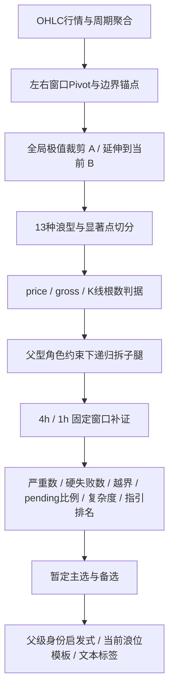

# 《波浪理论详解》到自动数浪算法的专项评审

评审结论：当前引擎已经实现部分书籍判据、候选竞争及跨周期取证，但尚不能视为《波浪理论详解》的忠实可执行实现。已确认的主要差异包括：多个严格不等号被闭区间吞掉、子浪角色表过宽、遗漏三角通道和父子限制、把递归深度当作者浪级，以及“已完成”与“未验证”状态并存。实现缺陷与书籍空白分别登记，不以网上流派定罪。

范围：主入口 `analyze-wave-tree.js`、`wave-subwave-verification.js`、主入口复用的 `analyze-wave-manual.js` 行情/Pivot/度量/通道函数，以及相关测试。旧 manual CLI 和 `analyze-kline-wave.js` 的所有独立规则没有逐条做第二份完整审计，不能把本报告外推为整个仓库都已认证。审核对象包含前几轮已经作出的改动，本轮未修改算法或既有测试。

首要依据：[本地书](D:/Workspace/crypto/books/波浪理论详解.epub)。已先完整读取前言及第1–7章的1121段，再开始本轮源码检查。没有第8–11章、没有固定页码。作者为柳玉冬，文件SHA256为 `4c7cd332cf0081392164177a6ead7dbcdc216c8b41b760a023e52325ec8e9b5b`。引用固定章节、小节、提取段落；[独立书籍基线](D:/Workspace/crypto/reports/wave-book-audit/book-rules-baseline.md)含核心条款和14项书内冲突，[阅读先行记录](D:/Workspace/crypto/reports/wave-book-audit/book-reading-record.md)记录检查顺序。没有借通用 Elliott 理论补齐缺章。

**用户确认的例外 OV-001**：Y>90%W 是书籍错误，本项目保留为指引，优先于原书p0024。此前对此项“理论错误”的结论撤回；代码与相关golden断言不因这项勘误而需要修改。[勘误记录](D:/Workspace/crypto/reports/wave-book-audit/book-rule-overrides.md)。其他未经用户确认的条文仍按书籍基线评审。

分类：**A**违反已有明确书籍条文；**B**工程/程序实现错误；**C**书籍未明确规定或当前来源不足；**U**书内有冲突，不能不披露冲突就裁定唯一规则。缺失规则表示“尚未覆盖这项书籍要求”，不自动证明任意最终输出都违反它。

## 1. 《波浪理论详解》的核心规则模型

书中将驱动浪 Motive 与推动浪 Impulse 区分为父子分类；驱动还包括引导楔形、终结楔形。“3”表示调整类型，不能理解成任何调整都只有三条腿；三角有五子浪，三锯齿也显示五段，均不能凭段数判驱动。主浪/子浪是相对关系，“主选”只是算法候选的排名称呼，并非书中另一种浪。级别是从属关系，通常兄弟子浪同级，但作者特别规定双锯齿Y比W低一级、三锯齿Z再低一级。§1.5、§1.7、§3.2、§7.2。[第1章 p0066](D:/Workspace/crypto/reports/wave-book-audit/book-extract/ch002.md:143) [第1章 p0149](D:/Workspace/crypto/reports/wave-book-audit/book-extract/ch002.md:335) [第3章 p0018](D:/Workspace/crypto/reports/wave-book-audit/book-extract/ch004.md:42) [第7章 p0066](D:/Workspace/crypto/reports/wave-book-audit/book-extract/ch008.md:135)

规则强度按 **Hard Rule / Soft Guideline / Typical Relationship / Optional Observation** 保存。原文§3.6：“规则指必须满足的条件。指引指不必完全符合的、经常出现的状态的总结。”验证顺序为浪型规则→比率规则→时间规则→三类指引；前三类任一明确失败要推翻假设，不能用比例相似、指引命中或少量越界救回。[第3章 p0047](D:/Workspace/crypto/reports/wave-book-audit/book-extract/ch004.md:104) [第3章 p0055](D:/Workspace/crypto/reports/wave-book-audit/book-extract/ch004.md:120)

| 结构 | 内部要求与硬边界（节选；完整条文见基线） | 允许/特殊与常见关系 |
| --- | --- | --- |
| 驱动1–5 | 五子浪；2不得回撤1的100%；3超过1终点且非1/3/5最短；4不得回撤3的100%；推动4任何内部子浪不得切入1；3的价格运动百分比另受约束。§1.5、§3.16、§6.20 | 3可第二长；交替是陡直/横向，非复杂度或单纯比率差；允许衰竭5但示例要求至少完成4的70%。详细推动/楔形专章缺失。[第1章 p0084](D:/Workspace/crypto/reports/wave-book-audit/book-extract/ch002.md:186) [第3章 p0123](D:/Workspace/crypto/reports/wave-book-audit/book-extract/ch004.md:267) [第6章 p0230](D:/Workspace/crypto/reports/wave-book-audit/book-extract/ch007.md:516) [第1章 p0134](D:/Workspace/crypto/reports/wave-book-audit/book-extract/ch002.md:304) [第3章 p0070](D:/Workspace/crypto/reports/wave-book-audit/book-extract/ch004.md:152) |
| 单锯齿 | A=推动/引导；B=任意调整；C=推动/终结；A引导不能配C终结；A/C不可同时5衰竭。B price在[.2A,A]且任何内部不越A起点；C≥.9B（等号冲突）、C<5B且C<5A；B/C相对指定前腿≤10倍时间。§4.1 | 失败C可在.9–1B；B允许等于A起点；扩散终结可作C；C≈A/.618A/1.618A仅常见，C>1.618A只提示可能演化推动。[第4章 p0007](D:/Workspace/crypto/reports/wave-book-audit/book-extract/ch005.md:15) [第4章 p0014](D:/Workspace/crypto/reports/wave-book-audit/book-extract/ch005.md:29) [第4章 p0016](D:/Workspace/crypto/reports/wave-book-audit/book-extract/ch005.md:33) [第4章 p0067](D:/Workspace/crypto/reports/wave-book-audit/book-extract/ch005.md:150) [第4章 p0073](D:/Workspace/crypto/reports/wave-book-audit/book-extract/ch005.md:163) |
| 平台形 | A/B均不得三角；C=推动/终结且C-5不得衰竭/截尾；B gross约[.7,2)A gross（等号冲突）；C与A重叠；C gross≤2max(A gross,B gross)且≤3A price；B/C时间≤指定前腿10倍。§5.1/5.3 | regular B≤A；expanded B>A且C超过A终点；running B>A、C不超A终点但仍重叠。出现频率、.95–1.4、1.236/1.618均属指引。[第5章 p0007](D:/Workspace/crypto/reports/wave-book-audit/book-extract/ch006.md:15) [第5章 p0053](D:/Workspace/crypto/reports/wave-book-audit/book-extract/ch006.md:112) [第5章 p0100](D:/Workspace/crypto/reports/wave-book-audit/book-extract/ch006.md:223) |
| 收缩三角 | A=锯齿类/平台；B=锯齿类；C/D=非三角调整；E=锯齿类/三角，EE不得再三角。A/C与B/D两线收缩、交点在E右侧、有限越线；B/A≥.5且<2，C/B≥.5且<1，D/C∈[.5,1]，E/D≥.25且<1；E回A区；D/E时间≤4C；A/C/D内部第二腿gross<1.05第一腿。§6.2–6.14 | 作者明确不承认扩散三角；允许B/D水平和E小幅越线，不能一律要求E贴线。E≈.7D仅常见。[第6章 p0009](D:/Workspace/crypto/reports/wave-book-audit/book-extract/ch007.md:20) [第6章 p0015](D:/Workspace/crypto/reports/wave-book-audit/book-extract/ch007.md:32) [第6章 p0021](D:/Workspace/crypto/reports/wave-book-audit/book-extract/ch007.md:44) [第6章 p0035](D:/Workspace/crypto/reports/wave-book-audit/book-extract/ch007.md:72) [第6章 p0118](D:/Workspace/crypto/reports/wave-book-audit/book-extract/ch007.md:261) |
| W-X-Y 双锯齿 | W/Y都必须**单锯齿**；X调整。X∈[.2W,W)；Y<5W、Y>X；W/Y的C不能失败；Y任意子浪不越0–X线；指定时间及价时联合约束。§7.1/7.3/7.4 | Y>.9W按用户确认勘误为指引；Y≈W/1.618W、X≈.3–.7W也为指引。W为双锯齿不能直接充当该双锯齿的W。[第7章 p0007](D:/Workspace/crypto/reports/wave-book-audit/book-extract/ch008.md:15) [第7章 p0024](D:/Workspace/crypto/reports/wave-book-audit/book-extract/ch008.md:49) [第7章 p0072](D:/Workspace/crypto/reports/wave-book-audit/book-extract/ch008.md:147) [第7章 p0082](D:/Workspace/crypto/reports/wave-book-audit/book-extract/ch008.md:172) |
| W-X-Y-XX-Z 三锯齿 | W/Y/Z必须单锯齿；X/XX调整；双锯齿共享条件，XX∈[.2Y,Y)，Z≥XX且Z<5Y、Z<5W；Z对X、XX有价时联合上限；Z路径不越0–X线。§7.1 | X可否三角在§6.17/图205与§7.3有冲突；不可凭通用理论静默选边。Z≈Y/.618Y/1.618Y仅指引。[第7章 p0028](D:/Workspace/crypto/reports/wave-book-audit/book-extract/ch008.md:57) [第7章 p0040](D:/Workspace/crypto/reports/wave-book-audit/book-extract/ch008.md:81) [第7章 p0084](D:/Workspace/crypto/reports/wave-book-audit/book-extract/ch008.md:177) |
| 双/三重横向整理 | §1.7定义为两/三个**简单调整**连接，X至少修正W约70%，三重XX修正Y约70%；三角不得作W，只可末端Y/Z。§1.7、§4.5、§6.17 | 联合形X不得三角有§4.5明文；完整第8章缺失，gross/price基准与完整上限不能凭现实现法当书证。[第1章 p0119](D:/Workspace/crypto/reports/wave-book-audit/book-extract/ch002.md:267) [第1章 p0123](D:/Workspace/crypto/reports/wave-book-audit/book-extract/ch002.md:277) [第4章 p0060](D:/Workspace/crypto/reports/wave-book-audit/book-extract/ch005.md:133) [第6章 p0200](D:/Workspace/crypto/reports/wave-book-audit/book-extract/ch007.md:447) |

书籍方法允许“先假设父型，再看低周期验证，失败返回修正”。§3.6和§3.10直接支持这种工作方式。因此对之前“父级先提候选就是强行贴标签”的泛化判断予以修正。日线看不清可下探更细K线，但书未规定必须恰好4小时/1小时；这只是当前实现的观察分辨率。[第3章 p0048](D:/Workspace/crypto/reports/wave-book-audit/book-extract/ch004.md:106) [第3章 p0081](D:/Workspace/crypto/reports/wave-book-audit/book-extract/ch004.md:175) [第1章 p0055](D:/Workspace/crypto/reports/wave-book-audit/book-extract/ch002.md:119)

## 2. 当前代码实现模型

Pipeline以 `detectPivots(lookback=1)`取high/low转折，用 `anchorBoundaryExtremes`补左边极值、右边provisional点；`directionalTopSpan`以样本全局高低裁剪A，B延伸到当前。`segmentations`用12个显著点、最多60套组合加贪心兜底；深层beam和maxDepth限制搜索。`PATTERNS`有13注册项，含平台通用与三个子型、引导/终结楔形，未注册扩散终结独立分支。根候选可并列推动/调整，子角色受父型集合限制。这种搜索本身是可用的工程近似，不是书中规定的穷尽否定法。

主排序见[compareCandidates](D:/Workspace/crypto/analyze-wave-tree.js:265)：严重越界数→硬失败数→越界和→pendingRatio→未完成度→复杂度→指引命中数→跨级命中。`scoreCandidate`虽按pattern/ratio/time排序求值，最终并未保留逐层优先级，且允许违规候选继续竞争。[selectBest](D:/Workspace/crypto/analyze-wave-tree.js:321)即使所有候选违反硬规则也返回最轻违规者为primary，必须与“合法主选”区分。

跨周期定位父端点所在完整桶，再找唯一小时极值，缺小时/重复端点/缺失K线保持pending。共享取数及窗口缓存是合理实现。4h/1h继续运行同一个受限decompose，最细没有独立可终止证明；失败被视为搜索受限或数据不足时保留未知。这里只做到补证尝试，没有完成理论验证闭环。[evaluate](D:/Workspace/crypto/wave-subwave-verification.js:57)

## 3. 两者差异：缺失、错误、额外、过限、过宽

| ID / 类型 / 优先级 | 书籍规则与原文依据 | 当前实现与结果 |
| --- | --- | --- |
| F01 已撤回 / 用户勘误 | 原书§7.1将Y>.9W列为硬规则，用户明确确认该处书籍错误，应降为指引。[第7章 p0024](D:/Workspace/crypto/reports/wave-book-audit/book-extract/ch008.md:49) | 现有双/三锯齿guideline实现保留，符合本项目采用的勘误；不进入修复清单。见[OV-001](D:/Workspace/crypto/reports/wave-book-audit/book-rule-overrides.md)。 |
| F02 B导致A / P1 边界 | §4.1 C<5B/<5A；§7.1 X<W、Y>X、Z<5Y/<5W；§6.2 C<B、E<D；§5.4 expanded/running B>A。[第4章 p0016](D:/Workspace/crypto/reports/wave-book-audit/book-extract/ch005.md:33) [第7章 p0022](D:/Workspace/crypto/reports/wave-book-audit/book-extract/ch008.md:45) [第7章 p0026](D:/Workspace/crypto/reports/wave-book-audit/book-extract/ch008.md:53) [第6章 p0033](D:/Workspace/crypto/reports/wave-book-audit/book-extract/ch007.md:68) [第5章 p0061](D:/Workspace/crypto/reports/wave-book-audit/book-extract/ch006.md:131) | [normRange](D:/Workspace/crypto/analyze-wave-tree.js:161)统一闭区间，调用者以同函数实现严格不等号。多个等号通过；应逐项实现开闭边界，不能统一把所有等号禁掉。 |
| F03 A / P1 子角色过宽 | 平台A/B必须非三角；驱动2不得三角；三角A/B/C/D/E分别限定类型；联合W和X不得三角。[第5章 p0007](D:/Workspace/crypto/reports/wave-book-audit/book-extract/ch006.md:15) [第6章 p0200](D:/Workspace/crypto/reports/wave-book-audit/book-extract/ch007.md:447) [第6章 p0015](D:/Workspace/crypto/reports/wave-book-audit/book-extract/ch007.md:32) [第4章 p0060](D:/Workspace/crypto/reports/wave-book-audit/book-extract/ch005.md:133) | [PATTERNS](D:/Workspace/crypto/analyze-wave-tree.js:958)大量统一CORRECTIVE；simple-corrective含triangle且用于联合W。角色表允许书中明确禁止组合，24项对照中7项复现此层错误；不是已经证明所有这些组合最终都成为主选。 |
| F04 A / P1 缺失 | 三角两线须收缩/交点在E右，C/D/E允许越线有不同10%基准；内部A/C/D第二腿<105%；E可三角但EE不得再三角。[第6章 p0021](D:/Workspace/crypto/reports/wave-book-audit/book-extract/ch007.md:44) [第6章 p0025](D:/Workspace/crypto/reports/wave-book-audit/book-extract/ch007.md:52) [第6章 p0036](D:/Workspace/crypto/reports/wave-book-audit/book-extract/ch007.md:74) [第6章 p0118](D:/Workspace/crypto/reports/wave-book-audit/book-extract/ch007.md:261) | [buildContractingTriangleManual](D:/Workspace/crypto/analyze-wave-tree.js:688)没有几何、路径、105%、EE上下文检查。通道在排名后仅投影；六点等幅平行结构手册八条全过。 |
| F05 A / P1 父子条件缺失 | 单锯齿A/C不可同时衰竭；平台C-5不得衰竭；双/三W/Y的C不可失败；Y/Z不得越0-X；三锯齿Z还不能同时price>5X且time>5X。[第4章 p0012](D:/Workspace/crypto/reports/wave-book-audit/book-extract/ch005.md:25) [第5章 p0053](D:/Workspace/crypto/reports/wave-book-audit/book-extract/ch006.md:112) [第7章 p0013](D:/Workspace/crypto/reports/wave-book-audit/book-extract/ch008.md:27) [第7章 p0040](D:/Workspace/crypto/reports/wave-book-audit/book-extract/ch008.md:81) [第7章 p0082](D:/Workspace/crypto/reports/wave-book-audit/book-extract/ch008.md:172) | 未实现衰竭配对/平台C截尾禁止/双锯齿C失败禁止；[buildTripleZigzagManual](D:/Workspace/crypto/analyze-wave-tree.js:822)有Y对X、Z对XX，缺Z对X；通道未参与有效性检查。 |
| F06 A / P1 过度限制 | §1.5：“3浪或者是最长的，或者是第二长。”[第1章 p0084](D:/Workspace/crypto/reports/wave-book-audit/book-extract/ch002.md:186) | [impulse.ratio.wave3-extend-range](D:/Workspace/crypto/analyze-wave-tree.js:373)强制3≥1，拒绝1=50/3=40/5=20的“3第二长”规则层反例；完整子浪与其余手册仍待验证。[当前⑤模板](D:/Workspace/crypto/analyze-wave-tree.js:2115)在5未完成前同样把3<1算硬失败，不能以“简化”替代非最短要求。 |
| F07 A / P1 特殊浪型遗漏 | §4.6：“扩散的终结楔形……出现在驱动浪的第5浪和单锯齿的c浪。”[第4章 p0067](D:/Workspace/crypto/reports/wave-book-audit/book-extract/ch005.md:150) | [buildDiagonalManual](D:/Workspace/crypto/analyze-wave-tree.js:408)对所有终结一律要求价格腿缩小、边界收缩，无扩散分支，排除作者明确允许的C/5特例。前轮增加通用收缩闸门不能当作最终修复；原BTC旧楔形是否属于作者扩散类型仍缺完整专章和子浪证据，不应反过来宣布它正确。 |
| F08 A / P1 度量/父子过宽 | 推动4“任意一个子浪”不得切入1；3的价格运动百分比不能同时小于1/5；衰竭5不足4的70%需否定。[第6章 p0230](D:/Workspace/crypto/reports/wave-book-audit/book-extract/ch007.md:516) [第3章 p0123](D:/Workspace/crypto/reports/wave-book-audit/book-extract/ch004.md:267) [第3章 p0070](D:/Workspace/crypto/reports/wave-book-audit/book-extract/ch004.md:152) | [推动手册](D:/Workspace/crypto/analyze-wave-tree.js:337)4只查p4端点；只比绝对长度不比各腿movePct；缺衰竭70%。判据层反例均复现。Pivot端点筛选有时另行拒绝隐藏极值，但不能代替OHLC完整路径检查或显式数法校验。 |
| F09 A / P1 浪级 | 作者Y比W低一级，Z再低一级。[第7章 p0066](D:/Workspace/crypto/reports/wave-book-audit/book-extract/ch008.md:135) | [serializeNode](D:/Workspace/crypto/analyze-wave-tree.js:3611)全部children写depth+1，双锯齿W/Y都degree=1。TF元数据没有弥补作者的级别特殊定义。 |
| F10 B / P1 验证不能终止 | 有限递归应有明确验证粒度与底层证据；书§3.23允许最细级别酌情处理，但没给机器终止公式。[第3章 p0192](D:/Workspace/crypto/reports/wave-book-audit/book-extract/ch004.md:418) | [leafNode](D:/Workspace/crypto/analyze-wave-tree.js:1352)总pending；[decompose](D:/Workspace/crypto/analyze-wave-tree.js:1679)要求每个子证据verified。真实最细验证器又调用相同规则，所以没有正常verified出口；mock注入可通过不代表真实路径可完成。 |
| F11 B / P1 完成与评分矛盾 | “较大把握地假设”完成、数浪需要再验证。[第2章 p0021](D:/Workspace/crypto/reports/wave-book-audit/book-extract/ch003.md:45) [第3章 p0036](D:/Workspace/crypto/reports/wave-book-audit/book-extract/ch004.md:81) | [annotateInProgress](D:/Workspace/crypto/analyze-wave-tree.js:1799)仅看末点provisional，就写完成；fixture根tier1=0/verification=pending，同时displayStatus=完成。框架Bdeferred只展示扣分，实际排名仍按原硬失败计，状态未同步。 |
| F12 B/C / P1–P2 排名证据 | 书要求假设受跨级验证；未规定pending比例、复杂度/严重阈值。[第3章 p0039](D:/Workspace/crypto/reports/wave-book-audit/book-extract/ch004.md:87) | pendingRatio分子计“本节点硬规则无已知失败”，分母随树形而变，未完成证据可积累为provenRoles；复杂结构与简单结构比较没有相同证明单位。0.5严重阈值/.25文法权重/6倍兄弟闸门是额外工程策略；不得冒充书籍硬规则。 |
| F13 B/C / P1 派生标签 | §4.5/§7.3类型依内部结构定义；书允许父假设，但须对子型求证。[第4章 p0050](D:/Workspace/crypto/reports/wave-book-audit/book-extract/ch005.md:104) [第7章 p0072](D:/Workspace/crypto/reports/wave-book-audit/book-extract/ch008.md:147) | [deriveCurrentInternal](D:/Workspace/crypto/analyze-wave-tree.js:2648)固定ABC，再在[renderCurrentInternalNote](D:/Workspace/crypto/analyze-wave-tree.js:2728)因外层为联合把内部换WXY，未证明此层是联合/双锯齿。JSON仍ABC，文字可WXY。父组合还只查drop是否corrective，不查W须简单。 |
| F15 B / P1 候选覆盖 | §4.7明确允许短C，§3.15终点不必最低/最高。[第4章 p0073](D:/Workspace/crypto/reports/wave-book-audit/book-extract/ch005.md:163) [第3章 p0107](D:/Workspace/crypto/reports/wave-book-audit/book-extract/ch004.md:233) | 默认directionalTopSpan把100→60→80→61裁成100→60并返回leaf；trimTop=false能保留zigzag/pending。全局极值锚不是所有书例都适用，不能只在手册层支持短C。 |
| F14 C/U / P2 来源待补 | 第8–11章缺失，已提供章节并无 .886 / 4.236 / 1.272 对应规则；2浪例证.2下限、80%上限与100%许可需分开。[第3章 p0134](D:/Workspace/crypto/reports/wave-book-audit/book-extract/ch004.md:291) [第1章 p0073](D:/Workspace/crypto/reports/wave-book-audit/book-extract/ch002.md:161) | .236–.886、3上限4.236作为推动硬阈值，1.272用于Z投影；来源不齐，不能只凭通用理论判错误。已明确3可第二长的下界冲突另列F06，不能用缺章掩盖。 |

重要已实现内容：单锯齿B的price范围与整段OHLC不越起点、C的大幅度和时间上限（严格等号问题另列）；平台B/C按gross与A price区分；三角D/C允许等于1、E至少.25D与≤4C时间；双/三锯齿W/Y/Z单锯齿角色；部分价时联合约束；比例多数以guideline计分。书籍与代码有这些一致点，不能因整体不完整否认所有已实现部分。

“C：暂未找到明确规则”适用于未知来源阈值、重复相等极值处理、beam/容差、全局锚点启发式，不适用于书中已经写出的禁用类型、扩散终结许可。精确边界冲突（单锯齿C=.9B、平台B=.7A/2A、三锯齿X=triangle等）见基线U01–U14，不与已确认边界Bug混写。

## 4. Structure / Label 是否混淆

核心decompose先枚举几何分段与形态、然后验证子浪，标签来自该形态的角色；这是部分正确的实现。`legCharacter`也尝试driving/corrective两类，并允许未决候选并列，符合书中假设法。父型限制哪些子浪可出现本身合法。§3.6“先假设一段波浪浪型，然后按照规则和指引做验证”。[第3章 p0048](D:/Workspace/crypto/reports/wave-book-audit/book-extract/ch004.md:106)

混淆发生在派生报告：ABC模板、①②③④⑤模板用有限已有枢轴直接指派；父级“联合”主选决定内部ABC改WXY，而非由内部Structure Candidate决定。反弹“更像5浪”还可被叙述为推动3浪及趋势转多，但5浪可能是A、C、1或5，不能单靠形态类别确认浪位/全局转势。书籍的出现位置要求父子配合，不支持这个跳步。[第4章 p0050](D:/Workspace/crypto/reports/wave-book-audit/book-extract/ch005.md:104) [第6章 p0201](D:/Workspace/crypto/reports/wave-book-audit/book-extract/ch007.md:449)

引擎klass区分driving/corrective正确，但楔形中文label仍写“推动浪（引导/终结楔形）”，与§1.5明确“不是同义词”的术语不符；应显示驱动浪族的楔形，并分别保留pattern与role。[第1章 p0066](D:/Workspace/crypto/reports/wave-book-audit/book-extract/ch002.md:143)

## 5. Parent / Child 是否一致

有部分双向机制：局部子腿两类竞争向上影响文法成本，父候选又下发角色集合。这优于只按外层比例贴字母，但还没有书籍要求的完整一致性验证。四处断点是：角色集合过宽；配对/截尾/通道上下文未覆盖；作者级别特例未表示；真实底层证明无出口。

跨周期证据只存到`evidence.attempts[].structure`，挂在`children`里的仍是本周期旧node。[evaluateLegRole](D:/Workspace/crypto/analyze-wave-tree.js:1443)用较小周期证据覆盖status，但不替换子结构；父层配对检查读旧children且要求所有evidence verified后才运行。今后即使补上verified出口，也可能出现“支持父角色的1h证据”和“报告展示的日线子树”不是同一解。应为每个候选明确记录所采用的证据树、浪级、端点和适用规则版本，而非只传一个status。

根相对degree=0可以用作局部树索引；不能把它称为书中全品种最大0级的认证。书§3.3/3.12要求全生命周期从0数起，目前只从用户指定2025-10区间高点起锚。当前算法能提供局部假设，缺全历史父级意味着全球浪位待定，不必因此拒绝用户的局部窗口分析。[第3章 p0023](D:/Workspace/crypto/reports/wave-book-audit/book-extract/ch004.md:52) [第3章 p0088](D:/Workspace/crypto/reports/wave-book-audit/book-extract/ch004.md:190)

## 6. Hard Rule 是否正确

部分正确，但还没有封闭的硬规则系统。原文§3.6对规则失败要求“立即推翻假设”，代码允许所有失败候选留在主排序；保留最接近失败方案作为诊断有用，但应隔离合法候选池，若合法池为空明确“暂无通过硬规则的主选”，不能把“最轻违规”写成可成立数浪。[第3章 p0055](D:/Workspace/crypto/reports/wave-book-audit/book-extract/ch004.md:120)

闭区间边界是B类通用工具错误，落到具体条文构成A类违反；应在rule元数据中明确`inclusiveMin/inclusiveMax`，有冲突的等号单独U标记。不能简单把normRange全面改开区间：B=.2A、zigzag B=A、triangle D=C、Z=XX等在详细手册中允许等号。

父型硬条件应独立于排序，包括完整路径高低、角色合法集合、配对、通道和价时联合约束。Pivot搜索漏解属于search_limited，不能冒充理论invalid；已明确观察到违反某硬规则的候选则应invalid，不能因为其他层待证把硬反例隐藏。

## 7. Soft Rule 是否被误当 Hard Rule

多数常见Fib比率、triangle E≈.7D、double X≈.3–.7W、C≈A/.618A/1.618A被放guidelines，这是正确方向。C>1.618A只让指引失分，不直接invalid，符合§4.13“更可能”语义。[第4章 p0142](D:/Workspace/crypto/reports/wave-book-audit/book-extract/ch005.md:327)

Y>.9W保留为Soft，属于用户确认的书籍勘误（OV-001），不再作为Hard降Soft错误。可确认的过强规则是3≥1（F06）；.236–.886及4.236上限的完整来源不齐，标额外硬限制/C，不假装已经在书中找到一句“通常”被升级的对应原文。

其他过度推断：单锯齿B“不接近A起点”量化为≤.9、C“远大于1.618”量化为≤1.618；这些仍为软项，主要影响排名。容差±.08/.1/.15/.2/.3/.4没有书籍校准。推动交替以回撤比率差>.15、或子patternId不同代表，书§1.7定义陡直/横向，且明确不是简单/复杂交替；这是软项含义实现偏差，不是硬失效。[第1章 p0134](D:/Workspace/crypto/reports/wave-book-audit/book-extract/ch002.md:304) [第1章 p0136](D:/Workspace/crypto/reports/wave-book-audit/book-extract/ch002.md:308)

复杂度1/2/3先于指引和跨级命中排序，注释称“书里明确多重调整是最后手段”；现有章节暂未找到对应断言，§7.2还说双锯齿经常出现。标为额外工程偏好，影响最终主选；不能用该偏好取代子浪证据。[第7章 p0064](D:/Workspace/crypto/reports/wave-book-audit/book-extract/ch008.md:131)

## 8. 完成状态判断是否正确

不正确且语义混用。`verificationStatus`的verified/pending/invalid衡量结构证据，`status`完成/进行中由末点provisional决定；Pivot右边出现一根确认K线不等于整浪已验证完成。24项对照fixture根为zigzag，tier1=0、pendingRatio≈.67778、verification=pending，但displayStatus=完成。真实图形已出现、结构待证、完成待确认是三个不同事实。

建议映射如下（工程设计，书没有原生四枚英文枚举）：

| 状态 | 能说什么 | 来源/边界 |
| --- | --- | --- |
| forming | 腿数/内部/末端在形成；适用硬条件实时检查，未可判项deferred | §4.14演化可能、§7.5持续延伸。[第4章 p0160](D:/Workspace/crypto/reports/wave-book-audit/book-extract/ch005.md:364) [第7章 p0092](D:/Workspace/crypto/reports/wave-book-audit/book-extract/ch008.md:195) |
| potentially_complete | 外形端点存在、无已知硬反例，内部或后续证据仍不足 | §3.5仍是假设。[第3章 p0036](D:/Workspace/crypto/reports/wave-book-audit/book-extract/ch004.md:81) |
| confirmed_complete | 按明确终止粒度完成适用规则与父子证据，后续走势增加确认；允许新证据推翻 | §2.5仅“有较大把握地假设”，不是不重数的绝对认证。[第2章 p0021](D:/Workspace/crypto/reports/wave-book-audit/book-extract/ch003.md:45) |
| invalidated | 已知违反适用明确硬规则，且针对这个候选/端点；不是网络缺失或预算用尽 | §3.6规则失败否定。[第3章 p0055](D:/Workspace/crypto/reports/wave-book-audit/book-extract/ch004.md:120) |

当前没有因为达到Fib直接设置`status=完成`的统一路径；不能杜撰这种Bug。已发现的是provisional=false直接完成，以及`zwaveProjection.trigger`把跌破前低称“确认Z启动”、报告把回撤带+折返写成确认条件。书未给这些足以确认指定Z/B角色的普适规则：应标工程触发参考，不能升级成浪位已确认。[第3章 p0036](D:/Workspace/crypto/reports/wave-book-audit/book-extract/ch004.md:81)

## 9. Fibonacci 是否符合书籍

数值出现与具体用途成立要分别检查。以下覆盖主要引擎、其复用工具、相关投影里的Fib值；代码中的数组索引、页数、舍入精度不是Fib规则。[基线数值表](D:/Workspace/crypto/reports/wave-book-audit/book-rules-baseline.md)另列.2/.25/.31/.7/.86/.9/1.05与时间上限。

| 数值 | 本地书的类别/出处 | 当前用途与结论 |
| --- | --- | --- |
| .236 | 常用回撤，Typical/辅助。§3.18.4 [第3章 p0144](D:/Workspace/crypto/reports/wave-book-audit/book-extract/ch004.md:312) | legacy回撤目标合理；tree作为2硬下限来源不足且与20%例证不同；Z“破位档”是额外目标经验，非书中确认条件。 |
| .382 | zigzag B、X常见，工具回撤。§4.1/7.1 [第4章 p0028](D:/Workspace/crypto/reports/wave-book-audit/book-extract/ch005.md:57) [第7章 p0046](D:/Workspace/crypto/reports/wave-book-audit/book-extract/ch008.md:93) | 多数soft/目标；“须站上.382才真正好转”等固定叙述没有对应书籍硬规则。 |
| .5 | triangle B/A等下限是Hard；常用回撤/扩展是Typical。[第6章 p0032](D:/Workspace/crypto/reports/wave-book-audit/book-extract/ch007.md:66) [第3章 p0166](D:/Workspace/crypto/reports/wave-book-audit/book-extract/ch004.md:363) | triangle用硬下限正确；父角色band中心或B须达到.5是额外启发式，不能用于所有平台B确认。 |
| .618 | 常见ABC/WXY长度、时间和triangle对腿关系。[第4章 p0029](D:/Workspace/crypto/reports/wave-book-audit/book-extract/ch005.md:59) [第7章 p0048](D:/Workspace/crypto/reports/wave-book-audit/book-extract/ch008.md:97) [第6章 p0050](D:/Workspace/crypto/reports/wave-book-audit/book-extract/ch007.md:102) | 通常soft/参考目标正确；同数值不代表各种从任意锚点投影都获书支持。 |
| .786 | 常用回撤；§4.14用强否定与同章手册冲突U03。[第3章 p0144](D:/Workspace/crypto/reports/wave-book-audit/book-extract/ch004.md:312) [第4章 p0152](D:/Workspace/crypto/reports/wave-book-audit/book-extract/ch005.md:348) | 工具目录可用；不得自行升为单锯齿全局硬上限；父zigzag band上限.79是近似额外策略。 |
| .886 | 当前第1–7章暂未找到 | tree和旧manual的2硬上限需来源；C类，不能仅凭通用理论判错误。 |
| 1.0 | 各结构不同：2/X禁等号、zigzag B与triangle D允许等号；C≈A、Y≈W为Typical | normRange吞严格等号有确定Bug；常见等长只可soft/投影。 |
| 1.236 | 平台典型B/C长度，Typical。§5.4 [第5章 p0058](D:/Workspace/crypto/reports/wave-book-audit/book-extract/ch006.md:124) [第5章 p0061](D:/Workspace/crypto/reports/wave-book-audit/book-extract/ch006.md:131) | legacy平台指引有来源；主tree平台只留少量指引，覆盖不完整。 |
| 1.272 | 当前第1–7章暂未找到 | Z投影使用；额外经验规则，影响目标不直接影响decompose分数。 |
| 1.382 | 顺势triangle B/A常见，Typical。§6.6 [第6章 p0102](D:/Workspace/crypto/reports/wave-book-audit/book-extract/ch007.md:224) | 主tree未作为典型比率项使用，属缺失软参考；不是必须满足。 |
| 1.618 | 常用扩展与ABC/WXY指引；C远超仅需重审。[第3章 p0166](D:/Workspace/crypto/reports/wave-book-audit/book-extract/ch004.md:363) [第4章 p0142](D:/Workspace/crypto/reports/wave-book-audit/book-extract/ch005.md:327) | 大多soft/投影正确；容差和参考浪须单独溯源。 |
| 2.618 | 常用扩展，辅助；平台问答上限存在U05。[第3章 p0166](D:/Workspace/crypto/reports/wave-book-audit/book-extract/ch004.md:363) [第5章 p0167](D:/Workspace/crypto/reports/wave-book-audit/book-extract/ch006.md:372) | 推动扩展指引/投影可作参考；不能因属于常用扩展就允许任何平台C=2.618A。 |
| 4.236 | 当前第1–7章暂未找到 | tree/旧manual把3硬上限设该值，C类来源待补，影响筛选和主选。 |
| Fib时间序列 | §3.22“经常但非绝对”，且比小时更小图不适合该工具。[第3章 p0175](D:/Workspace/crypto/reports/wave-book-audit/book-extract/ch004.md:383) [第3章 p0180](D:/Workspace/crypto/reports/wave-book-audit/book-extract/ch004.md:393) [第3章 p0184](D:/Workspace/crypto/reports/wave-book-audit/book-extract/ch004.md:401) | 根预测模块不参与打分正确；未限制更细TF，还用固定时间间隔投影股票日期，没有交易日历。书籍适用域与工程日期计算应补检查。 |

当前generic `computeExpectation`以首腿为任意末腿参考，未按类型落实书§3.19针对3/5/C/Y/Z不同锚点；旧工具`fibExtensionPoints`支持不少正确锚点，但主tree多数投影绕过它。书§3.19规定Z用X→Y段并从XX起算，统一“Z=W=Y”等长带不是该规则本身。[第3章 p0156](D:/Workspace/crypto/reports/wave-book-audit/book-extract/ch004.md:339) [第3章 p0158](D:/Workspace/crypto/reports/wave-book-audit/book-extract/ch004.md:344) [第3章 p0160](D:/Workspace/crypto/reports/wave-book-audit/book-extract/ch004.md:349) [第3章 p0162](D:/Workspace/crypto/reports/wave-book-audit/book-extract/ch004.md:354) [第3章 p0164](D:/Workspace/crypto/reports/wave-book-audit/book-extract/ch004.md:359)

## 10. 是否存在 forced labeling / Rule Overreach

存在局部证据，但不能把所有父型假设都归入此类。被书籍认可的top-down假设应保留；问题是候选标签凌驾子结构证明，或把未知变成事实。

1. `deriveCurrentInternal`先确定ABC、外层联合又让渲染换WXY，未用此层结构决定；JSON/文本两套字母不一致（F13）。
2. `buildCurrentWaveStructures`先指派浪③/浪②/浪⑤，再以极少条件作排序。作为明确pending的情景模板可以保留，但不能替代完整Structural Candidate；尤其⑤模板用3≥1错误淘汰书允许的第二长3。
3. `deriveParentDegree`在drop/bounce未verified时对所有父候选设置hardOk=true，再用[0,.5]/[.5,1.05]/[.5,.79]band排序；保留未知候选是合理的，但`hardOk`不该同时意味着规则通过。更大联合W只验证corrective，不查simple，扩大书定义。
4. `wave3Checklist`以存在p1/p2就说存在可识别1/合规2，未核角色证明；反弹5浪→推动3/全局转势跳过父级位置。应显示“具备该情景的局部条件，角色仍待验证”。
5. “跌破前低确认Z”“B须涨到.5/.618/.7”没有书中统一充分条件；是C类额外推断，不能标为书籍要求。

对应判断依据是书§3.5要求假设验证、§4.5/§7.3对子型要求，工程上则要求证据与标签同源。[第3章 p0039](D:/Workspace/crypto/reports/wave-book-audit/book-extract/ch004.md:87) [第4章 p0050](D:/Workspace/crypto/reports/wave-book-audit/book-extract/ch005.md:104) [第7章 p0072](D:/Workspace/crypto/reports/wave-book-audit/book-extract/ch008.md:147)

## 11. 是否存在 hindsight bias / repaint

**重数/重绘：存在且部分是书籍允许的假设修正。未来数据泄漏到回测：有明确风险，但本轮没有执行完整策略回测，因此不能报告一个未测得的收益偏差数。**书§3.5本就说不断修正；不允许重数并不是本次理论正确性的要求。[第3章 p0036](D:/Workspace/crypto/reports/wave-book-audit/book-extract/ch004.md:81)

`detectPivots`需要右侧lookback根K线，转折发生时尚不可用；序列只记timestamp/index，没有`observedAt/confirmedAt`。连续同类型取更极值会替换旧候选；边界provisional随新价格变化；全局高低起终锚与显著点、A/B主选也会随end重建。一次全窗口结果标在历史转折K线，是事后重构，不能把那个标签当成当日就知道。当前输出不是严格在线可复现的波浪流。[Pivot代码](D:/Workspace/crypto/analyze-wave-manual.js:388)

跨周期locate要求完整父桶，日线/周线极值唯一小时的定位同样要等桶内数据可得。`endTs`截断和不完整桶pending有保护作用，应保留；如未来做回测仍要记录证据可用时间，不能只看极值event timestamp。crypto主CLI没有与股票一样剔除未收盘K线，实时OHLC可变化，也需显式barClosed状态。

[applyInProgressRuleGate](D:/Workspace/crypto/analyze-wave-tree.js:2925)微移末点2%但不重算candles/gross，对端点规则可变、gross规则不变；只能算展示启发式，不是证明“沿合法路径延长必能解除此规则”。建议完成规则的逐项可判定性元数据后再修正排序与状态。

验证尚未完成的工程项目：逐bar前缀回放、确认时间检查、重复峰/同bar高低事件顺序、未收盘bar变化、断小时和跨源OHLC不一致、周/股交易日历、beam扩大敏感性。书籍没有定义这套测试，归B/C工程层，不能冒称理论条款。

## 12. P0 / P1 / P2 / P3 修改优先级及验收

| 优先级 | 修改对象 | 应得到的可检查行为 |
| --- | --- | --- |
| P0 | 合法候选与失败诊断分开；保留用户确认的Y>.9W软指引 | 没有合法主选就输出待证/暂无，不用违规最少充当成立；Y/W≈.879不能单独构成硬失败。不得恢复OV-001为硬规则，也不能顺手宣布新的唯一浪型。 |
| P1 | 开闭边界、角色集合、三角几何/路径/105%/EE、衰竭与C失败/配对、3非最短百分比、Z对X价时、作者degree特例 | 基于书籍对应测试通过；特殊允许与禁止都覆盖，有冲突边界显示U而不静默处理。 |
| P1 | 扩散终结分支；3≥1过强限制；按完整路径查2/4；同步main/intraday证明；真实验证终止粒度、四态、deferred实际评分 | 书中扩散C不被通用收缩阈值提前排除；第二长3可保留；真实证据有可审计verified出口，未知不算proven、未证不写完成；底层豁免策略标工程选择。 |
| P1 | 标签/父角色/报告统一取当前采用的Structure Candidate与证据；隔离情景模板 | 同一数据JSON/Markdown浪型、字母、状态一致；父联合不自动强制内部WXY。 |
| P2 | 规则注册表source/strength/basis/endpoint openness/applicability；额外阈值目录；指引含义与分层排名、候选证明覆盖单位 | 56条已实现硬判据与19条指引都能指回书籍或明确标extra/U；复杂度和engine权重不能伪装书规则；.886/4.236来源待补。 |
| P2 | 类型专用Fib锚点、通道几何、日期日历、book case corpus扩充 | 输出逐条说明参考浪、价格/gross与目标用途，补全.95/1.4/1.236/1.382等软参考；目标不自动确认浪位。 |
| P3 | beam敏感性、prefix回放与性能度量；原始书例OHLC数据归档 | 不把图形归一化案例称为历史行情复现，不以事后结果作在线成功率；日志可解释从何处开始偏离。若用于回测，as-of防泄漏应提升至P1。 |

建议顺序：先修确定的书籍硬规则与证据语义，再补角色/父子/特殊浪型，最后校准排序、目标和搜索预算。缺失专章不妨碍修复已提供章节的明确错误；缺章内容不能用通用资料暗填为Hard Rule。

### 本次BTC讨论对应的判断

`126296 → 80524.65 → 97963.62 → 57717.55`：W=45771.35、X=17438.97、Y=40246.07，Y/W≈0.879285。按用户确认的OV-001，Y>90%W是指引，**不能仅因Y/W≈.879否定双锯齿**。W/Y是否分别为单锯齿、其他硬规则与完成状态须独立验证；比率失分不等于完整结构已成立。若解释为其他调整，必须重新按那一类的书籍手册验证，不能用“WXY”三个字母统一跳过差别。[第7章 p0024](D:/Workspace/crypto/reports/wave-book-audit/book-extract/ch008.md:49)

用户提出的局部 `126296 → 103516.75 → 116410.06 → 80524.65` 可作为单锯齿候选；现有单锯齿自身价格/时间检查并不因三段形状排除它。但A须推动/引导，C须推动/终结，配对和衰竭限制还待证。代码较小周期找到“无已知自身失败”的推动候选，是补证进展，尚不是干净成立的确认。也不能把B终点116410.06到另一个C起点116077.51之间的价格运动跳过：需说明端点时间/嵌套，保证父子连贯。§4.1/§4.10。[第4章 p0007](D:/Workspace/crypto/reports/wave-book-audit/book-extract/ch005.md:15) [第4章 p0121](D:/Workspace/crypto/reports/wave-book-audit/book-extract/ch005.md:280)

前轮BTC报告存储时刻为2026-10-02T06:45:03Z，样本362根；本次是本地源码与固化fixture评审，未重新运行`--end now`的联网行情，故不把那份快照冒充当前新行情。现有primary“单锯齿”只能称算法的暂定排序，本次证据不足以确认它是唯一正确数浪。

## 附录A：书籍案例与可复现结果

运行 `node reports/wave-book-audit/run-book-cases.js`，输出[case-results.json](D:/Workspace/crypto/reports/wave-book-audit/case-results.json)。共24项分层检查，包含规则/角色/整树输出；不是24个完整实盘浪型测试。书图没有精确OHLC者只按关系归一化，明确保留“完整子浪待验证”。

| 书例/反例 | 书籍答案 vs 程序 | 最早偏离 |
| --- | --- | --- |
| §3.5图54：B越A起点 | 一致：B不越A起点判据拒绝；合成价格100→60→105→45，未声称重建原图K线 | Rule检查正确 |
| §4.7图95：失败C | 一致（价格层）：100→60→80→61，C/B=.95通过；A/C内部535未在图形归一化中复原 | 无该层偏离；完整Structure未判 |
| §4.7图95短C的完整根候选覆盖 | 不一致（搜索覆盖）：默认根裁剪只留100→60，丢短C；trimTop=false保留zigzag/pending；完整子角色仍未验证 | Pivot→顶层区间裁剪，早于Rule/Candidate |
| §3.8图57：衰竭5不足4的70% | 不一致（规则层）：100→120→110→170→130→155，5/4=.625，手册零失败 | Rule缺少衰竭下限 |
| §3.16图66对应价格百分比规则 | 不一致（规则层）：10→110→60→180→111→351，绝对3非最短而pct3同时短于1/5，手册零失败 | Measure→Rule未比较各腿pct |
| §6.2不允许平行及C=B/E=D | 不一致（规则层）：100→60→100→60→100→60，八条手册全部通过 | Rule开闭边界/通道未进入合法性 |
| §5.1/§6.4/§6.17角色反例 | 不一致（注册表）：平台A/B三角、推动2三角、三角B平台/C三角/E平台、联合W三角均被允许 | Structure角色集过宽；不等于这些都通过完整搜索 |
| §7.1真实BTC Y/W<.9，用户勘误OV-001 | 一致（自身规则层）：Y>.9W为软指引，.879不单独构成硬失败；子浪与其他硬规则另验 | 无该项偏离；保留现有实现 |
| §7.2双锯齿Y低一级 | 不一致（整树序列化）：W/Y均degree=1 | Candidate→Degree |
| §4.6图94扩散终结C | 部分一致/特殊分支缺失：允许C取ending名称，但ending所有判据强制收缩；无原始OHLC故未宣称复原图94答案 | Structure库不含该特殊分支 |
| §4.5图91–93、§5.3图127–128 | 部分一致：引导A+终结C约束代码存在但真实verified前不运行；双衰竭/平台C截尾限制缺失；没有图中完整OHLC，未运行实盘还原 | Parent-Child后置约束缺失/被状态闸门阻断 |
| 固化BTC整树314日线/96Pivot | verification verified=0、pending=649、invalid=176、leaf=1287；根zigzag/pending却status完成 | 有限验证无出口，标签语义分裂 |

既有 `node --test tests/*.test.js`：**176/176通过**。这证明当前测试支持现有行为，不证明书籍一致性；golden中Y/W≈.879不构成自身硬失败的断言符合用户勘误，不因这项比率需要修订；仍需分别验证子浪约束。案例脚本故意记录差异而不修改实现，它运行成功不表示24项全部理论合格。

扩散终结、图片实际价格、全部书例的完整父子答案仍受缺章/无原始OHLC限制，标部分一致或无法判断，不编造书籍行情结果。图56的正文讲收缩终结，而图片标引导，且§1.5与§5.11对楔形4入1有冲突，不能拿这一张图直接决定所有楔形重叠规则。

## 附录B：每条已实现判据的书籍→代码映射

以下覆盖主tree注册手册的56个唯一rule与19个唯一guideline；重复用于平台子型或两种楔形的判据合并。已列出处不代表现实现法全正确，结论栏说明边界/适用范围。书有而代码没有的内容见F03–F09及基线条款。机器目录为[implemented-rules.json](D:/Workspace/crypto/reports/wave-book-audit/implemented-rules.json)。

| 代码判据 / 当前类型 | 书籍规则来源 | 具体实现及一致性 |
| --- | --- | --- |
| [impulse.pattern.wave2-not-retrace-100](D:/Workspace/crypto/analyze-wave-tree.js:341) / rule·pattern | [第1章 p0073](D:/Workspace/crypto/reports/wave-book-audit/book-extract/ch002.md:161) | 2浪不能折返1浪的100%；部分正确：严格端点；缺完整2路径的极值上下文 |
| [impulse.pattern.wave3-exceeds-wave1-end](D:/Workspace/crypto/analyze-wave-tree.js:347) / rule·pattern | [第1章 p0075](D:/Workspace/crypto/reports/wave-book-audit/book-extract/ch002.md:165) | 3浪须超过1浪的终点；正确（端点层） |
| [impulse.pattern.wave4-not-cross-wave1](D:/Workspace/crypto/analyze-wave-tree.js:353) / rule·pattern | [第6章 p0230](D:/Workspace/crypto/reports/wave-book-audit/book-extract/ch007.md:516) | 推动浪的4浪不能切入1浪；部分正确：只查p4，缺所有内部子浪高低 |
| [impulse.pattern.wave3-not-shortest](D:/Workspace/crypto/analyze-wave-tree.js:359) / rule·pattern | [第1章 p0084](D:/Workspace/crypto/reports/wave-book-audit/book-extract/ch002.md:186) | 3浪一定不是1/3/5浪中最短的；绝对长度正确；§3.16价格运动百分比另缺 |
| [impulse.ratio.wave2-retrace-range](D:/Workspace/crypto/analyze-wave-tree.js:368) / rule·ratio | [第3章 p0134](D:/Workspace/crypto/reports/wave-book-audit/book-extract/ch004.md:291) | 2浪回撤须在1浪的23.6%~88.6%之间；额外硬限制：.236–.886来源未找到；例证下限.2 |
| [impulse.ratio.wave3-extend-range](D:/Workspace/crypto/analyze-wave-tree.js:373) / rule·ratio | [第1章 p0084](D:/Workspace/crypto/reports/wave-book-audit/book-extract/ch002.md:186) | 3浪相对1浪的扩展须在1~4.236倍之间；错误：≥1排除3第二长；4.236上限来源待补 |
| [impulse.guide.alternation-2-4](D:/Workspace/crypto/analyze-wave-tree.js:381) / guideline·pattern | [第1章 p0134](D:/Workspace/crypto/reports/wave-book-audit/book-extract/ch002.md:304) | 2浪与4浪呈现交替（回撤比率不同）；软项类别正确，但比率差>.15不是书定义的陡直/横向交替 |
| [impulse.guide.wave3-common-extension](D:/Workspace/crypto/analyze-wave-tree.js:389) / guideline·ratio | [第3章 p0166](D:/Workspace/crypto/reports/wave-book-audit/book-extract/ch004.md:363) | 3浪扩展接近常见斐波那契倍数（1.618/2.618）；1.618/2.618属于常用扩展，具体3常见范围缺专章；容差额外 |
| [impulse.guide.wave4-time-balance](D:/Workspace/crypto/analyze-wave-tree.js:395) / guideline·time | [第3章 p0046](D:/Workspace/crypto/reports/wave-book-audit/book-extract/ch004.md:102) | 4浪与2浪耗时比在0.2~5倍之间（时间平衡）；具体.2–5倍4/2暂未找到来源；额外软策略 |
| [diagonal.pattern.wave2-not-retrace-100](D:/Workspace/crypto/analyze-wave-tree.js:415) / rule·pattern | [第1章 p0073](D:/Workspace/crypto/reports/wave-book-audit/book-extract/ch002.md:161) | 2浪不能折返1浪的100%；部分正确：端点层，缺完整子浪路径 |
| [diagonal.pattern.wave3-exceeds-wave1-end](D:/Workspace/crypto/analyze-wave-tree.js:419) / rule·pattern | [第1章 p0075](D:/Workspace/crypto/reports/wave-book-audit/book-extract/ch002.md:165) | 3浪须超过1浪的终点；正确（端点层） |
| [diagonal.pattern.wave4-allowed-cross-wave1](D:/Workspace/crypto/analyze-wave-tree.js:423) / rule·pattern | [第1章 p0078](D:/Workspace/crypto/reports/wave-book-audit/book-extract/ch002.md:172) | 楔形允许4浪切入1浪，但须落在2、1浪终点之间；U01：强制进入1与另节说仅经常进入1存在书内冲突 |
| [diagonal.pattern.wave4-not-retrace-100-of-3](D:/Workspace/crypto/analyze-wave-tree.js:429) / rule·pattern | [第1章 p0081](D:/Workspace/crypto/reports/wave-book-audit/book-extract/ch002.md:179) | 4浪不能折返3浪的100%；正确（端点层） |
| [diagonal.pattern.wave3-not-shortest](D:/Workspace/crypto/analyze-wave-tree.js:433) / rule·pattern | [第1章 p0084](D:/Workspace/crypto/reports/wave-book-audit/book-extract/ch002.md:186) | 3浪一定不是最短的；绝对长度层符合通用驱动规则 |
| [diagonal.pattern.boundaries-converge](D:/Workspace/crypto/analyze-wave-tree.js:439) / rule·pattern | [第4章 p0067](D:/Workspace/crypto/reports/wave-book-audit/book-extract/ch005.md:150) | 楔形的1–3与2–4边界须向未来收敛；可作为收缩分支几何定义，完整判据缺专章；统一所有终结会排除扩散特例 |
| [diagonal.ratio.converging](D:/Workspace/crypto/analyze-wave-tree.js:452) / rule·ratio | [第4章 p0067](D:/Workspace/crypto/reports/wave-book-audit/book-extract/ch005.md:150) | 楔形须收敛：3浪短于1浪、5浪短于3浪；过度限制：无扩散终结分支；收缩具体长度规则缺专章 |
| [diagonal.guide.wave5-time-shorter](D:/Workspace/crypto/analyze-wave-tree.js:462) / guideline·time | [第3章 p0046](D:/Workspace/crypto/reports/wave-book-audit/book-extract/ch004.md:102) | 5浪耗时通常短于3浪；缺楔形专章，暂未找到该具体指引 |
| [zigzag.ratio.b-price-between-0.2a-and-a](D:/Workspace/crypto/analyze-wave-tree.js:478) / rule·ratio | [第4章 p0014](D:/Workspace/crypto/reports/wave-book-audit/book-extract/ch005.md:29) | b浪价格须在a浪的20%~100%之间；符合验证手册；B=A另有概述/问答冲突U03 |
| [zigzag.ratio.b-not-break-a-start](D:/Workspace/crypto/analyze-wave-tree.js:482) / rule·ratio | [第4章 p0015](D:/Workspace/crypto/reports/wave-book-audit/book-extract/ch005.md:31) | b浪任何部分不能超过a浪起点；正确：检查窗口OHLC极值（端点桶事件顺序另属工程） |
| [zigzag.ratio.c-between-0.9b-and-5b](D:/Workspace/crypto/analyze-wave-tree.js:489) / rule·ratio | [第4章 p0016](D:/Workspace/crypto/reports/wave-book-audit/book-extract/ch005.md:33) | c浪须≥b浪90%且<b浪5倍且<a浪5倍；错误：5倍等号不应通过；.9精确下界U02 |
| [zigzag.time.b-lt-10a](D:/Workspace/crypto/analyze-wave-tree.js:496) / rule·time | [第4章 p0019](D:/Workspace/crypto/reports/wave-book-audit/book-extract/ch005.md:39) | b浪时间≤a浪10倍；正确（按bar数度量时间；未建交易/缺bar语义） |
| [zigzag.time.c-lt-10a-and-10b](D:/Workspace/crypto/analyze-wave-tree.js:500) / rule·time | [第4章 p0020](D:/Workspace/crypto/reports/wave-book-audit/book-extract/ch005.md:41) | c浪时间≤a、b浪10倍；正确上限及且关系；按bar数度量 |
| [zigzag.guide.b-common-ratio](D:/Workspace/crypto/analyze-wave-tree.js:509) / guideline·ratio | [第4章 p0028](D:/Workspace/crypto/reports/wave-book-audit/book-extract/ch005.md:57) | b浪接近常见比率(0.382/0.5/0.618)；符合常见目录；未编码常见顺序；±.08为额外容差 |
| [zigzag.guide.c-common-ratio](D:/Workspace/crypto/analyze-wave-tree.js:514) / guideline·ratio | [第4章 p0029](D:/Workspace/crypto/reports/wave-book-audit/book-extract/ch005.md:59) | c浪接近常见比率(1/0.618/1.618)；部分覆盖：缺从A终点扩展.618A的第四常见关系；±.1额外 |
| [zigzag.guide.b-not-approach-a-start](D:/Workspace/crypto/analyze-wave-tree.js:520) / guideline·ratio | [第4章 p0023](D:/Workspace/crypto/reports/wave-book-audit/book-extract/ch005.md:47) | b浪通常不接近a浪起点（回撤≤a的90%）；软语义方向符合；.9阈值额外，另有.86及U03 |
| [zigzag.guide.c-not-far-beyond-1.618a](D:/Workspace/crypto/analyze-wave-tree.js:526) / guideline·ratio | [第4章 p0030](D:/Workspace/crypto/reports/wave-book-audit/book-extract/ch005.md:61) | c浪未远超a浪的1.618倍（否则更像推动浪）；保持软项正确；远超量化为一超过即失分是工程近似 |
| [zigzag.guide.b-time-window](D:/Workspace/crypto/analyze-wave-tree.js:532) / guideline·time | [第4章 p0033](D:/Workspace/crypto/reports/wave-book-audit/book-extract/ch005.md:67) | b浪时间通常介于a浪的61.8%~161%；按手册.618–1.61；正文1.618，非硬界限 |
| [flat.ratio.b-gross-at-least-70pct-of-a](D:/Workspace/crypto/analyze-wave-tree.js:561) / rule·ratio | [第5章 p0012](D:/Workspace/crypto/reports/wave-book-audit/book-extract/ch006.md:25) | b浪运行总量须≥a浪70%；gross基准正确；.7等号U04 |
| [flat.ratio.b-gross-below-200pct-of-a](D:/Workspace/crypto/analyze-wave-tree.js:565) / rule·ratio | [第5章 p0013](D:/Workspace/crypto/reports/wave-book-audit/book-extract/ch006.md:27) | b浪运行总量须<a浪2倍；与手册<2不符，定义允许=2，精确边界U04 |
| [flat.ratio.c-overlaps-a](D:/Workspace/crypto/analyze-wave-tree.js:569) / rule·ratio | [第5章 p0014](D:/Workspace/crypto/reports/wave-book-audit/book-extract/ch006.md:29) | c浪必须与a浪有价格重叠；方向与gross检查部分正确；子角色与截尾禁止另缺 |
| [flat.ratio.c-gross-limit](D:/Workspace/crypto/analyze-wave-tree.js:575) / rule·ratio | [第5章 p0015](D:/Workspace/crypto/reports/wave-book-audit/book-extract/ch006.md:31) | c浪运行总量≤max(a,b)的2倍 且 ≤a价格的3倍；符合手册两个条件同时满足；问答上限冲突U05 |
| [flat.time.b-lt-10a](D:/Workspace/crypto/analyze-wave-tree.js:581) / rule·time | [第5章 p0018](D:/Workspace/crypto/reports/wave-book-audit/book-extract/ch006.md:37) | b浪时间≤a浪10倍；正确上限；按bar数 |
| [flat.time.c-lt-10a-and-10b](D:/Workspace/crypto/analyze-wave-tree.js:585) / rule·time | [第5章 p0019](D:/Workspace/crypto/reports/wave-book-audit/book-extract/ch006.md:39) | c浪时间≤a、b浪10倍；正确指定前腿和且关系；按bar数 |
| [flat.guide.c-common-ratio](D:/Workspace/crypto/analyze-wave-tree.js:594) / guideline·ratio | [第5章 p0032](D:/Workspace/crypto/reports/wave-book-audit/book-extract/ch006.md:65) | c浪接近常见比率(c=a 或 c=1.618a)；部分覆盖1/1.618，缺A终点及从A终点扩展.618A |
| [flat-regular.ratio.b-le-a](D:/Workspace/crypto/analyze-wave-tree.js:607) / rule·ratio | [第5章 p0058](D:/Workspace/crypto/reports/wave-book-audit/book-extract/ch006.md:124) | 规则平台形：b浪运行总量≤a浪；正确≤1（各腿gross） |
| [flat-expanded.ratio.b-gt-a](D:/Workspace/crypto/analyze-wave-tree.js:619) / rule·ratio | [第5章 p0061](D:/Workspace/crypto/reports/wave-book-audit/book-extract/ch006.md:131) | 扩散平台形：b浪运行总量>a浪；错误：>1实现成≥1 |
| [flat-expanded.pattern.c-exceeds-a-end](D:/Workspace/crypto/analyze-wave-tree.js:623) / rule·pattern | [第5章 p0061](D:/Workspace/crypto/reports/wave-book-audit/book-extract/ch006.md:131) | 扩散平台形：c浪须超过a浪终点；正确严格超过端点 |
| [flat-running.ratio.b-gt-a](D:/Workspace/crypto/analyze-wave-tree.js:636) / rule·ratio | [第5章 p0068](D:/Workspace/crypto/reports/wave-book-audit/book-extract/ch006.md:147) | 顺势平台形：b浪运行总量>a浪；错误：>1实现成≥1 |
| [flat-running.pattern.c-not-exceed-a-end](D:/Workspace/crypto/analyze-wave-tree.js:640) / rule·pattern | [第5章 p0068](D:/Workspace/crypto/reports/wave-book-audit/book-extract/ch006.md:147) | 顺势平台形：c浪不超过a浪终点；端点上限正确；本模式还需禁c截尾 |
| [zigzag-double.ratio.x-retrace-20-100](D:/Workspace/crypto/analyze-wave-tree.js:767) / rule·ratio | [第7章 p0021](D:/Workspace/crypto/reports/wave-book-audit/book-extract/ch008.md:43) | x浪价格须回撤w浪价格的20%~100%；部分正确：下限.2；上限<1实现成≤1 |
| [zigzag-double.ratio.y-lt-5w](D:/Workspace/crypto/analyze-wave-tree.js:772) / rule·ratio | [第7章 p0025](D:/Workspace/crypto/reports/wave-book-audit/book-extract/ch008.md:51) | y浪价格须<w浪5倍；错误：<5实现成≤5；>.9W按OV-001保留为指引 |
| [zigzag-double.ratio.y-gt-x](D:/Workspace/crypto/analyze-wave-tree.js:776) / rule·ratio | [第7章 p0026](D:/Workspace/crypto/reports/wave-book-audit/book-extract/ch008.md:53) | y浪价格须大于x浪价格的1倍；错误：>1实现成≥1 |
| [zigzag-double.time.x-lt-5w](D:/Workspace/crypto/analyze-wave-tree.js:780) / rule·time | [第7章 p0035](D:/Workspace/crypto/reports/wave-book-audit/book-extract/ch008.md:71) | x浪时间≤w浪5倍；符合手册≤5W |
| [zigzag-double.time.y-lt-5w](D:/Workspace/crypto/analyze-wave-tree.js:784) / rule·time | [第7章 p0036](D:/Workspace/crypto/reports/wave-book-audit/book-extract/ch008.md:73) | y浪时间≤w浪5倍；符合手册≤5W；§6.11旁述≤10W冲突U14 |
| [zigzag-double.time.y-not-both-5x](D:/Workspace/crypto/analyze-wave-tree.js:788) / rule·time | [第7章 p0037](D:/Workspace/crypto/reports/wave-book-audit/book-extract/ch008.md:75) | y浪不能既价格>x浪5倍又时间>x浪5倍；正确：禁止价/时同时超过；不是或关系 |
| [zigzag-double.guide.x-retrace-30-70](D:/Workspace/crypto/analyze-wave-tree.js:796) / guideline·ratio | [第7章 p0046](D:/Workspace/crypto/reports/wave-book-audit/book-extract/ch008.md:93) | x浪通常回撤w浪的30%~70%；软项区间符合；未按.382/.5/.618常见排序 |
| [zigzag-double.guide.y-gt-0.9w](D:/Workspace/crypto/analyze-wave-tree.js:802) / guideline·ratio | [第7章 p0024](D:/Workspace/crypto/reports/wave-book-audit/book-extract/ch008.md:49) | y浪价格通常>w浪90%（非必须）；符合用户确认勘误OV-001；保留为指引，不恢复硬下限 |
| [zigzag-double.guide.y-near-w-or-1.618](D:/Workspace/crypto/analyze-wave-tree.js:807) / guideline·ratio | [第7章 p0048](D:/Workspace/crypto/reports/wave-book-audit/book-extract/ch008.md:97) | y浪价格倾向=w浪或1.618倍w浪；软项符合；容差额外 |
| [zigzag-double.guide.x-time-window](D:/Workspace/crypto/analyze-wave-tree.js:812) / guideline·time | [第7章 p0056](D:/Workspace/crypto/reports/wave-book-audit/book-extract/ch008.md:113) | x浪时间通常介于w浪的61.8%~161.8%；软项符合 |
| [zigzag-triple.ratio.x-retrace-20-100](D:/Workspace/crypto/analyze-wave-tree.js:824) / rule·ratio | [第7章 p0021](D:/Workspace/crypto/reports/wave-book-audit/book-extract/ch008.md:43) | x浪价格须回撤w浪价格的20%~100%；部分正确：下限.2；上限应<1 |
| [zigzag-triple.ratio.y-lt-5w](D:/Workspace/crypto/analyze-wave-tree.js:829) / rule·ratio | [第7章 p0025](D:/Workspace/crypto/reports/wave-book-audit/book-extract/ch008.md:51) | y浪价格须<w浪5倍；错误：<5实现成≤5；>.9W按OV-001保留为指引 |
| [zigzag-triple.ratio.y-gt-x](D:/Workspace/crypto/analyze-wave-tree.js:833) / rule·ratio | [第7章 p0026](D:/Workspace/crypto/reports/wave-book-audit/book-extract/ch008.md:53) | y浪价格须大于x浪价格的1倍；错误：>1实现成≥1 |
| [zigzag-triple.ratio.xx-retrace-20-100](D:/Workspace/crypto/analyze-wave-tree.js:837) / rule·ratio | [第7章 p0028](D:/Workspace/crypto/reports/wave-book-audit/book-extract/ch008.md:57) | xx浪价格须回撤y浪价格的20%~100%；部分正确：下限.2；上限应<1 |
| [zigzag-triple.ratio.z-vs-xx-y-w](D:/Workspace/crypto/analyze-wave-tree.js:841) / rule·ratio | [第7章 p0031](D:/Workspace/crypto/reports/wave-book-audit/book-extract/ch008.md:63) | z浪须≥xx浪1倍、<y浪5倍、<w浪5倍；Z≥XX正确；<5Y/<5W等号错误 |
| [zigzag-triple.time.x-lt-5w](D:/Workspace/crypto/analyze-wave-tree.js:849) / rule·time | [第7章 p0035](D:/Workspace/crypto/reports/wave-book-audit/book-extract/ch008.md:71) | x浪时间≤w浪5倍；正确≤5W |
| [zigzag-triple.time.y-lt-5w](D:/Workspace/crypto/analyze-wave-tree.js:853) / rule·time | [第7章 p0036](D:/Workspace/crypto/reports/wave-book-audit/book-extract/ch008.md:73) | y浪时间≤w浪5倍；符合手册≤5W；旁述U14 |
| [zigzag-triple.time.z-lt-5w-5y](D:/Workspace/crypto/analyze-wave-tree.js:857) / rule·time | [第7章 p0038](D:/Workspace/crypto/reports/wave-book-audit/book-extract/ch008.md:77) | z浪时间≤w浪5倍且≤y浪5倍；正确两个≤5同时满足 |
| [zigzag-triple.time.y-not-both-5x](D:/Workspace/crypto/analyze-wave-tree.js:864) / rule·time | [第7章 p0037](D:/Workspace/crypto/reports/wave-book-audit/book-extract/ch008.md:75) | y浪不能既价格>x浪5倍又时间>x浪5倍；正确共享Y对X的价时联合限制 |
| [zigzag-triple.time.z-not-both-5xx](D:/Workspace/crypto/analyze-wave-tree.js:868) / rule·time | [第7章 p0041](D:/Workspace/crypto/reports/wave-book-audit/book-extract/ch008.md:83) | z浪不能既价格>xx浪5倍又时间>xx浪5倍；正确Z对XX；但§7.1 Z对X联合限制未实现 |
| [zigzag-triple.guide.x-retrace-30-70](D:/Workspace/crypto/analyze-wave-tree.js:874) / guideline·ratio | [第7章 p0046](D:/Workspace/crypto/reports/wave-book-audit/book-extract/ch008.md:93) | x浪通常回撤w浪的30%~70%；软项符合，具体常见次序未覆盖 |
| [zigzag-triple.guide.xx-retrace-30-70](D:/Workspace/crypto/analyze-wave-tree.js:879) / guideline·ratio | [第7章 p0049](D:/Workspace/crypto/reports/wave-book-audit/book-extract/ch008.md:99) | xx浪通常回撤y浪的30%~70%；软项符合，具体常见次序未覆盖 |
| [zigzag-triple.guide.y-gt-0.9w](D:/Workspace/crypto/analyze-wave-tree.js:885) / guideline·ratio | [第7章 p0024](D:/Workspace/crypto/reports/wave-book-audit/book-extract/ch008.md:49) | y浪价格通常>w浪90%（非必须）；符合用户确认勘误OV-001；保留为指引，不恢复硬下限 |
| [sideways-double.ratio.x-retrace-70pct-of-w](D:/Workspace/crypto/analyze-wave-tree.js:655) / rule·ratio | [第1章 p0119](D:/Workspace/crypto/reports/wave-book-audit/book-extract/ch002.md:267) | x浪须回撤w浪运行总量的70%以上；70%阈值有来源；gross基准待缺失第8章核实，上界缺片段约束 |
| [sideways-triple.ratio.x-retrace-70pct-of-w](D:/Workspace/crypto/analyze-wave-tree.js:668) / rule·ratio | [第1章 p0123](D:/Workspace/crypto/reports/wave-book-audit/book-extract/ch002.md:277) | x浪须回撤w浪运行总量的70%以上；70%阈值有来源；gross基准待第8章核实 |
| [sideways-triple.ratio.xx-retrace-70pct-of-y](D:/Workspace/crypto/analyze-wave-tree.js:674) / rule·ratio | [第1章 p0123](D:/Workspace/crypto/reports/wave-book-audit/book-extract/ch002.md:277) | xx浪须回撤y浪运行总量的70%以上；70%阈值有来源；gross基准待第8章核实 |
| [triangle.pattern.longest-is-a-or-b](D:/Workspace/crypto/analyze-wave-tree.js:692) / rule·pattern | [第6章 p0029](D:/Workspace/crypto/reports/wave-book-audit/book-extract/ch007.md:60) | 最长子浪只能是a或b（c/d/e 不能最长）；部分正确：按端点price比较，完整gross/路径几何另缺 |
| [triangle.pattern.e-within-a-range](D:/Workspace/crypto/analyze-wave-tree.js:699) / rule·pattern | [第6章 p0030](D:/Workspace/crypto/reports/wave-book-audit/book-extract/ch007.md:62) | e浪终点必须回到a浪价格区域内；符合E终点区域要求（端点层） |
| [triangle.ratio.b-vs-a](D:/Workspace/crypto/analyze-wave-tree.js:708) / rule·ratio | [第6章 p0032](D:/Workspace/crypto/reports/wave-book-audit/book-extract/ch007.md:66) | b浪价格须≥a浪50%且<a浪2倍；错误：<2实现成≤2 |
| [triangle.ratio.c-vs-b](D:/Workspace/crypto/analyze-wave-tree.js:712) / rule·ratio | [第6章 p0033](D:/Workspace/crypto/reports/wave-book-audit/book-extract/ch007.md:68) | c浪价格须<b浪且≥b浪50%；错误：<1实现成≤1 |
| [triangle.ratio.d-vs-c](D:/Workspace/crypto/analyze-wave-tree.js:716) / rule·ratio | [第6章 p0034](D:/Workspace/crypto/reports/wave-book-audit/book-extract/ch007.md:70) | d浪价格须≤c浪且≥c浪50%；符合手册[.5,1]及水平B-D特例；概述措辞U09 |
| [triangle.ratio.e-vs-d](D:/Workspace/crypto/analyze-wave-tree.js:720) / rule·ratio | [第6章 p0035](D:/Workspace/crypto/reports/wave-book-audit/book-extract/ch007.md:72) | e浪价格须<d浪且≥d浪25%；错误：<1实现成≤1；.25下限符合手册 |
| [triangle.time.d-le-4c](D:/Workspace/crypto/analyze-wave-tree.js:724) / rule·time | [第6章 p0041](D:/Workspace/crypto/reports/wave-book-audit/book-extract/ch007.md:84) | d浪时间≤c浪4倍；正确上限≤4C，不是与B/D任意比较 |
| [triangle.time.e-le-4c](D:/Workspace/crypto/analyze-wave-tree.js:728) / rule·time | [第6章 p0042](D:/Workspace/crypto/reports/wave-book-audit/book-extract/ch007.md:86) | e浪时间≤c浪4倍；正确上限≤4C，不是≤4D |
| [triangle.guide.618-pair](D:/Workspace/crypto/analyze-wave-tree.js:736) / guideline·ratio | [第6章 p0050](D:/Workspace/crypto/reports/wave-book-audit/book-extract/ch007.md:102) | 通常有一对同向浪比例约61.8%（c/a 或 d/b）；软项符合；只测C/A与D/B，未覆盖所有同向对 |
| [triangle.guide.e-retrace-70-of-d](D:/Workspace/crypto/analyze-wave-tree.js:742) / guideline·ratio | [第6章 p0052](D:/Workspace/crypto/reports/wave-book-audit/book-extract/ch007.md:106) | e浪通常回撤d浪的70%；软项符合；±.15额外 |

### 书中存在但当前注册判据未覆盖（补充）

| 书籍条款 | 应落入位置 | 状态 |
| --- | --- | --- |
| A/C不能双衰竭（[第4章 p0012](D:/Workspace/crypto/reports/wave-book-audit/book-extract/ch005.md:25)） | `evaluateChildRoles` | 缺失 |
| A引导不能配C终结（[第4章 p0011](D:/Workspace/crypto/reports/wave-book-audit/book-extract/ch005.md:23)） | `evaluateChildRoles` | 代码有，但真实全verified前不检查 |
| C可扩散终结且不可失败C（[第4章 p0067](D:/Workspace/crypto/reports/wave-book-audit/book-extract/ch005.md:150)） | `PATTERNS / diagonal variant` | 无独立扩散分支/组合约束 |
| 平台C-5不得衰竭/截尾（[第5章 p0053](D:/Workspace/crypto/reports/wave-book-audit/book-extract/ch006.md:112)） | `flat后置父子规则` | 缺失 |
| 三角各腿子型集合（[第6章 p0015](D:/Workspace/crypto/reports/wave-book-audit/book-extract/ch007.md:32)） | `PATTERNS / context roles` | 仅泛corrective |
| 收缩/唯一水平线/交点在E右（[第6章 p0021](D:/Workspace/crypto/reports/wave-book-audit/book-extract/ch007.md:44)） | `triangle geometry` | 未用于Rule |
| C/D/E越线各自10%gross基准（[第6章 p0025](D:/Workspace/crypto/reports/wave-book-audit/book-extract/ch007.md:52)） | `triangle full-path validator` | 缺失 |
| A/C/D第二子浪<105%第一gross（[第6章 p0036](D:/Workspace/crypto/reports/wave-book-audit/book-extract/ch007.md:74)） | `triangle parent-child validator` | 缺失 |
| E可三角但EE不再三角（[第6章 p0118](D:/Workspace/crypto/reports/wave-book-audit/book-extract/ch007.md:261)） | `recursive context` | 缺失 |
| 驱动2、平台A/B、联合W等禁三角（[第6章 p0200](D:/Workspace/crypto/reports/wave-book-audit/book-extract/ch007.md:447)） | `role registry` | 缺失/过宽 |
| 推动4所有子浪不得切入1（[第6章 p0230](D:/Workspace/crypto/reports/wave-book-audit/book-extract/ch007.md:516)） | `impulse path validator` | 仅末点 |
| W/Y的C不能失败（[第7章 p0013](D:/Workspace/crypto/reports/wave-book-audit/book-extract/ch008.md:27)） | `double/triple parent-child validator` | 缺失 |
| Z对X不得价时都超5倍（[第7章 p0040](D:/Workspace/crypto/reports/wave-book-audit/book-extract/ch008.md:81)） | `triple time/price rule` | 缺失 |
| Y任意子浪不越0-X（[第7章 p0082](D:/Workspace/crypto/reports/wave-book-audit/book-extract/ch008.md:172)） | `double channel path validator` | 缺失 |
| Z任意子浪不越0-X（[第7章 p0084](D:/Workspace/crypto/reports/wave-book-audit/book-extract/ch008.md:177)） | `triple channel path validator` | 缺失 |
| Y/W及Z/Y相差一个作者级别（[第7章 p0066](D:/Workspace/crypto/reports/wave-book-audit/book-extract/ch008.md:135)） | `degree model/serializer` | depth+1不符合特例 |
| 3的价格运动百分比不能最短（[第3章 p0123](D:/Workspace/crypto/reports/wave-book-audit/book-extract/ch004.md:267)） | `impulse leg measure validator` | 有movePct工具，未用于此规则 |
| 衰竭5至少完成4的70%（[第3章 p0070](D:/Workspace/crypto/reports/wave-book-audit/book-extract/ch004.md:152)） | `impulse failure validator` | 仅truncated注记，未验证 |
| 推动2时间≤9倍1（[第4章 p0094](D:/Workspace/crypto/reports/wave-book-audit/book-extract/ch005.md:213)） | `impulse time validator` | 缺失，完整第9章未提供 |
| 驱动4时间>2倍3可推翻（[第3章 p0171](D:/Workspace/crypto/reports/wave-book-audit/book-extract/ch004.md:374)） | `motive time validator` | 缺失，例证来源，缺完整细则 |
| 联合X gross最多1.5W gross（[第6章 p0145](D:/Workspace/crypto/reports/wave-book-audit/book-extract/ch007.md:322)） | `sideways upper rule` | 书内已有片段，当前仅70%下限；完整第8章仍缺 |
| 双重横向Y时间≤5W（[第6章 p0149](D:/Workspace/crypto/reports/wave-book-audit/book-extract/ch007.md:332)） | `sideways time validator` | 已有片段，当前未覆盖 |
| 联合X不可三角（[第4章 p0060](D:/Workspace/crypto/reports/wave-book-audit/book-extract/ch005.md:133)） | `sideways X role` | 泛corrective过宽 |

### 额外工程参数与来源空白

| 参数/做法 | 影响 | 来源结论 |
| --- | --- | --- |
| SEVERE_OVERSHOOT=.5 | 改变失败诊断排名 | 本地书暂未规定该机械策略，标额外工程规则；检查是否越过Hard Rule或改变证据语义 |
| GRAMMAR_OVERSHOOT=.25 | 子角色失败的越界权重 | 本地书暂未规定该机械策略，标额外工程规则；检查是否越过Hard Rule或改变证据语义 |
| 复杂度1/2/3 | 优先单结构，早于指引 | 本地书暂未规定该机械策略，标额外工程规则；检查是否越过Hard Rule或改变证据语义 |
| 兄弟浪最大/最小振幅≤6（仅B） | 额外硬闸门，改变B排序 | 本地书暂未规定该机械策略，标额外工程规则；检查是否越过Hard Rule或改变证据语义 |
| pendingRatio节点计数 | 树形改变分母，改变主选 | 本地书暂未规定该机械策略，标额外工程规则；检查是否越过Hard Rule或改变证据语义 |
| 父角色band与中心距离 | X/B/转势身份排序 | 本地书暂未规定该机械策略，标额外工程规则；检查是否越过Hard Rule或改变证据语义 |
| 12显著点/60组合/beam/maxDepth | 可能漏解，不能当完备性证明 | 本地书暂未规定该机械策略，标额外工程规则；检查是否越过Hard Rule或改变证据语义 |
| ±.08/.1/.15/.2/.3/.4、价格精度半tick | 比率指引与端点匹配容差 | 本地书暂未规定该机械策略，标额外工程规则；检查是否越过Hard Rule或改变证据语义 |
| 端点相等极值要求唯一小时 | 未知保持pending，合理保守工程选择 | 本地书暂未规定该机械策略，标额外工程规则；检查是否越过Hard Rule或改变证据语义 |
| 全局高低作为主树首尾、末腿终点必须极值 | 可能排除书允许终点≠极值的特殊结构 | 本地书暂未规定该机械策略，标额外工程规则；检查是否越过Hard Rule或改变证据语义 |
| 2%微移末点判deferred | 只反映局部端点判据，不重算gross | 本地书暂未规定该机械策略，标额外工程规则；检查是否越过Hard Rule或改变证据语义 |
| 小时缺口必须连续、数据页298h/3并发 | 覆盖与取数策略，非理论规则 | 本地书暂未规定该机械策略，标额外工程规则；检查是否越过Hard Rule或改变证据语义 |

终点筛选尤其需重新核对书§3.15/3.16：作者明确起终点不必是整体最高/最低。[原文](D:/Workspace/crypto/reports/wave-book-audit/book-extract/ch004.md:233)。`legEndpointsSpanExtreme`与`finalLegAnchored`把某些内部/末端锚点固定为跨度极值，可能提前排除失败C/衰竭嵌套。具体各段是否必然误删仍需按书例端点和路径重放，不能仅凭手册短C通过就宣布全搜索覆盖正确。
