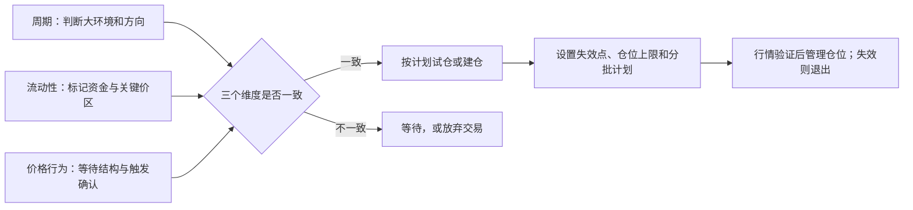

# 半木夏交易理论：可复盘的框架总结

> 本文整理公开材料中反复出现的交易思路，用于学习和复盘，不构成投资建议或交易信号。加密资产波动和杠杆风险极高；任何公开收益、胜率和资金规模均不等于可验证、可复制的结果。

## 先说结论

半木夏的思路不是一个“看到某个指标就下单”的单一策略，更接近一套由三层判断和一层纪律组成的框架：

1. **周期**决定大方向和当前市场所处阶段；
2. **流动性／预期**标记价格可能被吸引或受阻的区域；
3. **价格行为**确认真正的入场、加仓或离场时机；
4. **仓位、止损与兑现**把单笔判断限制在可承受风险内。

只有前三层相互支持时才考虑出手；判断不清楚时，等待本身就是交易计划的一部分。



## 1. 它是什么，不是什么

### 是：一个多维度、重计划的波段交易框架

公开材料中，半木夏早期会使用均线、支撑阻力、K 线、MACD 背离等技术工具；后续的解读普遍将其归纳为“周期 + 流动性 + 价格行为”的交叉验证。工具会随阶段变化，但核心不是迷信某一条均线或 MACD 参数，而是先看环境、再找位置、最后等确认。

### 不是：一套保证高胜率的指标公式

网上常见“固定 MACD 参数”“百分之多少胜率”“小资金翻多少倍”等说法，多数来自二次解读或当事人自述，缺少独立审计、完整对账单和统一回测口径。它们不能当作策略有效性的证据，更不应直接换成自动下单规则。

## 2. 三层判断

| 层次 | 要回答的问题 | 常见观察内容 | 在决策中的作用 |
| --- | --- | --- | --- |
| 周期 | 市场在上涨、下跌、震荡，还是阶段转换？ | 大级别趋势、历史结构、宏观／行业预期、均线与波段位置 | 给出方向偏好，避免逆着大环境重仓 |
| 流动性／预期 | 哪些价位可能聚集止损、挂单或获利盘？ | 前高前低、密集成交区、关键支撑阻力、重大事件后的预期差 | 找到值得关注的目标区和风险区 |
| 价格行为 | 市场是否在关键区域给出了可执行的确认？ | 突破与回踩、K 线与结构、趋势线、成交与动能变化 | 决定此刻进、加、减还是继续等 |

### 周期：先判断“现在适不适合做”

周期不是精确预测某天涨跌，而是确定交易的背景和方向优先级。例如，大级别上行中，优先寻找回调后的做多机会；方向不清、结构杂乱时，降低参与度。这样做的重点是少犯方向性错误，而不是每天都要交易。

### 流动性：把价格看成会寻找筹码的过程

这一层关注市场参与者可能集中的位置：显眼的前高前低、密集成交区、支撑阻力和容易触发止损的区域。它提供的是“哪里值得等”，不是“价格一定会到哪里”。

### 价格行为：用市场实际走法做最后确认

当周期方向和关键价区都准备好后，再观察走势是否确认，例如关键位突破后能否站稳、回踩是否承接、结构是否延续。均线、MACD 背离和形态是辅助证据，而非脱离市场环境的独立开关。

## 3. 一笔交易的执行链

以下是把上述思想落成交易计划的通用顺序；它是整理后的复盘模板，不是对某次具体行情的建议。

1. **写下假设**：当前处于什么阶段，偏多、偏空还是观望；依据是什么。
2. **圈出关键区**：目标流动性区域、支撑阻力和可能失效的位置。
3. **定义触发条件**：没有确认前不进场；确认失败就继续等待。
4. **开仓前先定风险**：明确仓位大小、止损（判断被否定的位置）、止盈／减仓计划和最大可承受亏损。
5. **分段管理**：行情按预期发展才考虑加仓；关键区兑现部分利润，避免把账面浮盈当作已实现收益。
6. **条件失效就退出**：止损的目的不是证明自己错了，而是把一次错误限制在预先接受的范围内。
7. **留下日志**：记录入场理由、风险、执行情况和事后偏差，以便验证规则而非只记结果。

## 4. 风控与心理纪律

公开叙事中最稳定的部分不是“找神点位”，而是以下纪律：

- **低风险首先指低风险位置，不只是不高的杠杆。** 方向、位置和失效点不清楚，即使仓位小也不算高质量机会。
- **不开无计划的单。** 入场前要知道为什么进、错在哪里出、对了怎么处理。
- **避免高频追涨杀跌。** 不明朗时等待，减少被短期波动和情绪驱动的操作。
- **加仓只服务于已被验证的判断。** 不能把逆势补仓包装成“滚仓”。
- **账面利润不等于收益。** 分批止盈、降低风险或按计划提取，都是防止利润回吐的管理动作。
- **控制杠杆与总风险。** 公开二手材料常提到其偏好低倍杠杆，但具体倍数会随时期、品种和材料而变化；学习时应把重点放在单笔最大损失和强平距离，而非照搬数字。

## 5. 早期技术工具如何放进框架

| 工具 | 合理用途 | 容易犯的错误 |
| --- | --- | --- |
| 均线 | 观察趋势、回踩和动态支撑阻力 | 金叉／死叉一出现就机械开仓 |
| MACD 背离 | 观察动能衰竭，作为关键区附近的辅助证据 | 把任意背离当成马上反转；忽略强趋势可持续背离 |
| 支撑阻力、前高前低 | 定义流动性区、目标区和失效边界 | 把一条线当成精确点位，忽略区域和确认 |
| K 线／形态 | 验证突破、回踩和结构是否成立 | 脱离周期与位置，孤立解读单根 K 线 |

## 6. 最常见的四个误读

1. **“低杠杆 = 没风险”**：低杠杆只能降低部分强平压力，错误位置、过大仓位和没有止损仍然危险。
2. **“背离 = 立即反转”**：背离只是动能信息，必须结合趋势、关键位置和后续价格确认。
3. **“滚仓 = 赚钱就一直加”**：正确的加仓应有前提、总风险上限和统一失效条件；逆势摊平不是滚仓。
4. **“复制收益数字即可复制方法”**：市场环境、流动性、资金规模、执行能力和幸存者偏差都不同，未审计的收益更不能作为预期。

## 7. 可直接使用的复盘清单

每一笔交易可用下面这组问题检查：

- 大级别周期的方向是什么？若方向不明，为什么仍要参与？
- 当前价格靠近哪一个流动性或关键价区？这个判断可被什么事实推翻？
- 价格行为给出的确认是什么？若没有确认，等待条件是什么？
- 入场、止损、第一目标、减仓和撤销计划分别在哪里？
- 这笔交易最多亏损多少；连续三笔止损后是否仍在总风险预算内？
- 本次加仓是顺势验证后放大，还是在为错误判断补仓？
- 结果出来后，流程问题在分析、执行还是风险控制？

## 8. 十种情形：框架应给出的动作

以下用来检查自己是否真的把三层判断和纪律放在一起。它们只是方法论示例，不是对任何品种的买卖建议。

| 输入情形 | 预期动作 |
| --- | --- |
| 1. 周期偏多，价格回到关键支撑区，且出现站稳确认 | 可以按预设风险考虑顺势试仓；止损仍须在入场前写明 |
| 2. 周期偏多，但价格已远离支撑并快速拉升 | 不因怕错过而追高，等待新的低风险位置或确认 |
| 3. 价格在支撑区出现反弹，但大级别周期仍偏空 | 不把单一反弹当作趋势反转；优先观望或降低参与度 |
| 4. 流动性目标清楚，但价格行为没有确认 | 等待，不能仅凭“可能会到”提前重仓 |
| 5. 三层判断一致，但止损和仓位无法定义 | 不开仓；可执行性不足等同于计划不完整 |
| 6. 已入场后价格有效跌破／突破原失效点 | 按计划止损或退出，不临时把错误改成长期持仓 |
| 7. 行情按预期发展并形成新确认 | 只在原计划允许、总风险不超标时顺势管理或加仓 |
| 8. 价格到达预定目标或关键流动性区 | 按计划分批止盈、上移保护或降低风险，而非临场贪婪 |
| 9. 连续多笔止损或明显偏离计划 | 降低频率和风险，复盘判断链与执行错误，不报复性交易 |
| 10. 看到“固定参数高胜率／暴利”宣传 | 视为待验证信息；没有完整样本、成本和风控，不纳入规则 |

## 9. 来源、可信度与阅读边界

| 来源 | 用途 | 可信度边界 |
| --- | --- | --- |
| [半木夏微博主页](https://weibo.com/u/2641166841) | 确认账号身份及其“只分享个人观点、不提供个人操作建议”的声明 | 本人公开渠道，但不能替代完整、可验证的交易记录 |
| [B 站：错误总结、圈子说明及我的交易系统详细介绍](https://www.bilibili.com/list/490128215?bvid=BV1E7411A7aF&oid=90191309) | 确认本人账号曾公开讲解交易系统、止盈止损和加仓判断 | 原始视频入口；本次未对视频逐帧转写，具体口径以原视频为准 |
| [半木夏交易日志整理](https://www.xtradingtime.com/books/banmuxia-trading-journal.pdf) | 了解其 2019—2020 年公开日志中的行情与仓位表述 | 第三方转载／整理，需回到原微博逐条校验 |
| [交易系统二次解读](https://2jmtt.com/dealings/2502/202502259900.html) | 补充“周期、流动性、价格行为”和常用技术工具的后期表述 | 二手材料，只用于交叉参考，不当作原话或绩效证明 |

## 一句话记忆

**先用周期决定方向，再用流动性选择位置，最后等价格行为确认；无计划不进、判断失效就退、利润按规则管理。**

---

## 脚本用法：`advise.js`

把本手册里**能确定计算**的部分落成了脚本：只用 Binance 已收盘 K 线，本地算 MA5/10/30/90/120/256、结构高低点、MACD 三段背离和 §15.1 市场状态，再按 §14 算风控。脚本**不会**编造均线数值，历史不足的指标写"数据不足"。输出的一切都是条件性计划，不构成投资建议。

```bash
# 点位模式：没有持仓，想知道哪些共振点位值得参与
node advise.js BTC-USD

# 持仓模式：给成本价和方向（缺 --side 会报错）；再给数量和权益，追加 §14 风控与减仓分步表
node advise.js BTC-USD --cost 78000 --side long
node advise.js BTC-USD --cost 78000 --side long --qty 0.1 --equity 10000 --liq 74000 --margin isolated

# 用手册 §20.2 的账户快照（yaml / json）代替命令行持仓参数，按快照里本交易对的仓位逐个输出
node advise.js BTC-USD --snapshot 半木夏交易理论/snapshot.example.yaml

# 事实 JSON 输出到 stdout，便于其他脚本复用（摘要走 stderr）
node advise.js ETHUSDT --json > eth-facts.json

# 可选：让 Claude 在事实之上写一段老手口吻的叙述（需 ANTHROPIC_API_KEY；叙述里出现事实 JSON 没有的数字会作废并回退模板）
ANTHROPIC_API_KEY=sk-... node advise.js BTC-USD --narrate --model claude-sonnet-5-5
```

### 参数说明

两种模式由 `--cost` 决定：**不带 `--cost` 是点位模式，带了就是持仓模式**（此时 `--side` 必填）。持仓参数只在持仓模式下有意义，单独给 `--qty` 之类会报错。

| 参数 | 取值 | 含义 |
|---|---|---|
| `SYMBOL` | `BTC-USD` / `btcusdt` / `ETHUSDT` | 交易对，统一解析为 Binance USDT 交易对（`-USD` 视同 `USDT`），只支持 USDT 计价 |
| `--cost` | 正数 | 你的持仓**成本价**（开仓均价，USDT）。脚本用它定位"成本在均线/共振区的哪里"、算"失效价止损相对成本的盈亏" |
| `--side` | `long` / `short` | 持仓方向，多 / 空。空单的失效价、止盈、亏损公式全部按镜像计算 |
| `--qty` | 正数 | 持仓**数量，单位是币**（BTC 就是几个 BTC，不是张数，也不是 USDT 金额）。和 `--equity` 一起给才会出 §14 风控 |
| `--equity` | 正数（USDT） | **这笔仓位所在风险池的权益**，已含浮盈亏。怎么填见下面"全仓与逐仓" |
| `--margin` | `cross` / `isolated` | 保证金模式：`cross` 全仓、`isolated` 逐仓；只有这两个值。不给则报告里标"待查" |
| `--lev` | 正数 | 你在交易所**设置的杠杆倍数**，仅用于在报告里记录和展示。风控用的是"实际杠杆"（名义价值 ÷ 权益），不是这个数 |
| `--liq` | 正数 | 交易所显示的**强平价**。给了才会判断"强平是否早于失效价止损"，并算强平距离现价的缓冲 |
| `--risk` | 0～1 的比例，默认 `0.01` | 单笔允许亏损占权益的比例（0.01 = 1%）。用来算风险预算 `权益 × 比例` 和仓位上限 `Q_max` |
| `--snapshot` | yaml / json 文件 | 手册 §20.2 账户快照，代替上面的持仓参数；只取与 `SYMBOL` 同一交易对的仓位，币本位仓位会跳过并注明 |
| `--narrate` | 开关 | 让 Claude 在事实之上写叙述；需要 `ANTHROPIC_API_KEY`，没设置或数字校验不过时回退模板并在报告里写明 |
| `--model` | 模型 ID | 只能与 `--narrate` 同用，默认 `claude-sonnet-5-5` |
| `--json` | 开关 | 事实 JSON 输出到 stdout，摘要改走 stderr |
| `--help` | 开关 | 打印用法 |

**全仓（`cross`）与逐仓（`isolated`）**

- **全仓**：所有全仓仓位共用一个保证金池。`--equity` 填这个池子的权益（快照里是 `totalMarginBalance`）。实际杠杆 = 名义价值 ÷ 这个权益。
- **逐仓**：每个仓位有自己单独的保证金（逐仓钱包），亏光就被强平，不牵连其他资金。`--equity` 填**这个仓位的逐仓钱包**（快照里是 `isolatedWallet`），不要填整个账户。
- 两者在报告里的差别：逐仓时，F 节"分步操作表"会把**实际杠杆分成两列**——
  - **保留保证金**：减仓后保证金不动，剩余仓位的杠杆 = 剩余名义价值 ÷ 逐仓钱包，会随减仓下降；
  - **释放保证金**：交易所按比例把保证金退回可用余额，剩余仓位的杠杆**不变**（等于减仓前的杠杆），风险并没有降。
  手册 §14.2 要求逐仓减仓时两种情形都要看，因为很多人以为"减仓了杠杆就低了"，其实取决于保证金有没有被释放。
- 全仓或没给 `--margin` 时只有一列杠杆，不分这两种情形。

**用那条命令举例**

```bash
node advise.js BTC-USD --cost 78000 --side long --qty 0.1 --equity 10000 --liq 74000 --margin isolated
```

含义：BTCUSDT 一笔**多单**，成本 78000，持有 **0.1 个 BTC**，这个**逐仓**仓位的钱包里有 **10000 USDT**，交易所给的强平价是 **74000**。风险比例没给，按默认 1%（风险预算 = 10000 × 1% = 100 USDT）。脚本会：

1. 算出结构失效价（成本所在或下方最近共振区、再下方最近的确认低点，减 0.3 倍 ATR），给出"失效价止损相对成本的盈亏"；
2. 用合约标记价（取不到就用现货收盘价）算名义价值、实际杠杆、从现价和从成本到失效价的亏损、占权益的比例、仓位上限；
3. 比较强平价和失效价：**多单强平价高于失效价**，就在结论首行提示"强平先于止损"；
4. 如果"从成本到失效价的亏损"超过 100 USDT（或实际杠杆高于参考线 3），按每步 25% 列出减仓表，直到亏损进预算，逐仓时同时列"保留 / 释放保证金"两种杠杆；
5. 给出 -3% / -5% / -10% 的理论压力损失，以及止损、减仓、持有、加仓各自的触发条件。

没给的字段不会被估算：比如不给 `--qty` / `--equity`，风险金额、杠杆、减仓表都标"待查"；不给 `--liq`，强平比较标"待查"。

**几个常见写法**

```bash
# 只知道成本和方向：看结构位置和失效价止损的盈亏，风控部分标"待查"
node advise.js BTC-USD --cost 78000 --side long

# 全仓空单，权益填整个全仓池，自定义每笔风险 2%
node advise.js ETHUSDT --cost 3000 --side short --qty 5 --equity 20000 --margin cross --risk 0.02

# 多个仓位（含多空双向、全仓逐仓混合）：写进快照文件，一次输出
node advise.js BTC-USD --snapshot 半木夏交易理论/snapshot.example.yaml
```

- 交易对写 `BTC-USD`、`btcusdt`、`ETHUSDT` 都行，统一解析为 Binance USDT 现货交易对。
- 终端打印摘要；完整报告写到 `reports/advise/<交易对>-<YYYYMMDD-HHmm>.md`（UTC），章节顺序为手册 §19.2 的 A–H，附录列出本次所有阈值及来源级别（A 本人 / B 转载 / D 手册执行建议）。阈值集中在 `advisor/params.js`。
- 周线由 UTC 日线按周一 00:00 切分合成，当周没走完不参与计算；结构与指标用现货 K 线，持仓风控的现价优先取合约公开接口的标记价（失败则退回现货收盘价并注明）。
- 币本位反向合约不支持；未提供的字段一律标"待查"，不估算。
- 若本机用代理上网，Node 的 `fetch` 默认不读代理环境变量，报 `fetch failed` 时在命令前加 `NODE_USE_ENV_PROXY=1`。
